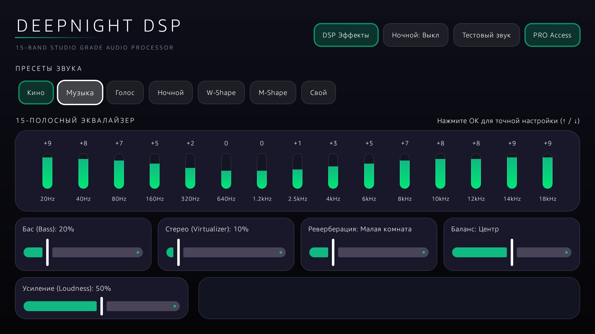

# 🎵 DEEPNIGHT DSP v1.0.4 — Multiplatform Studio Audio Processor

> **Автор идеи и концепта**: **`~ИГОРЬ~ (4PDA)`**  
> **Официальный профиль GitHub**: [Igor1974](https://github.com/Igor1974)  
> **Официальные релизы**: [Скачать сборки (Releases)](https://github.com/Igor1974/DeepNight-DSP/releases)

---

---

## 🌟 О программе

**DeepNight DSP** — это высокопроизводительный мультиплатформенный 15-полосный аудиопроцессор студийного класса на базе нативного **C++20 ядра**, разработанный для **Android TV**, **Linux Desktop (PipeWire / PulseAudio)** и **Windows Desktop (WASAPI Loopback)**.

Программа кардинально улучшает звучание любых колонок, саундбаров и наушников благодаря субмиллисекундной фильтрации частот в реальном времени.

---

## 🚀 Поддерживаемые Платформы:

| Платформа | Технология обработки | Интерфейс / Режим | Релизный пакет |
| :--- | :--- | :--- | :--- |
| **Android TV / Смарт-ТВ** | Native C++ NDK Engine | Compose TV UI & Background Service | `DeepNight_DSP_v1.0.4.apk` |
| **Linux Desktop** | PipeWire / PulseAudio Monitor | GTK3 Cosmic GUI & System Daemon (`deepnight-dspd`) | `DeepNight_DSP_v1.0.4-Linux-x86_64.tar.gz` |
| **Windows Desktop** | WASAPI Loopback Engine | Win32 Native App & CLI Utility | `DeepNight_DSP_v1.0.4-Windows-x64.zip` |

---

## 🆓 Что доступно БЕСПЛАТНО и БЕССРОЧНО (FREE-версия):
Даже когда тестовый период истекает, приложение **НЕ заблокируется** и продолжит работать:
1. **Основной переключатель DSP-эффектов** (`DSP Эффекты: Вкл / Выкл`).
2. **Базовый сброс на 0 дБ** (плоская чистая АЧХ).
3. **Автозапуск вместе с системой** при включении ПК или ТВ.
4. **Фоновый защищенный сервис/демон обработки звука**.
5. **Спектроанализатор спектра в реальном времени**.

---

## 👑 Что дает PRO-версия (за 390 ₽ один раз и навсегда):
PRO-лицензия разблокирует профессиональные инструменты точной настройки:
1. **Кастомный набор звуковых пресетов** (*Кино, Музыка, Голос, Ночной, W-Shape, M-Shape*).
2. **Ручная 15-полосная точечная подстройка эквалайзера** (от 20 Гц до 18 кГц с дБ-индикацией).
3. **Усиление суб-баса (Sub-Bass Boost)** и пространственная **3D-стереопанорама (Virtualizer)**.
4. **Регулятор Loudness Gain и точный баланс каналов L/R**.
5. **6 профилей студийной реверберации** (*Small Room, Large Room, Medium Hall, Large Hall, Plate*).
6. **Единая лицензия**: один ключ активации подходит для всех ваших устройств!

---

## 💳 Инструкция по активации PRO:
1. Отсканируйте QR-код в приложении или перейдите на страницу оплаты **[ЮMoney (390 руб.)](https://yoomoney.ru/to/41001983944189)**.
2. Отправьте ваш **ID устройства** (например: `DSP-LNX-IGOR-MINIPC`, отображается в шапке приложения) на email: **Deep-Nigth@ya.ru**
3. Введите полученный 12-значный ключ активации в поле «Enter PRO Key...» и нажмите «Activate» (или вызовите утилиту CLI: `deepnight-dsp-cli activate <KEY>`).

---

## 📥 Скачать

Готовые релизные пакеты для всех систем доступны в разделе **[Releases](https://github.com/Igor1974/DeepNight-DSP/releases)**:
- 🪟 **[Windows x64 Release ZIP](https://github.com/Igor1974/DeepNight-DSP/releases)** (`DeepNight_DSP_v1.0.4-Windows-x64.zip`)
- 🐧 **[Linux x86_64 AppImage Bundle](https://github.com/Igor1974/DeepNight-DSP/releases)** (`DeepNight_DSP_v1.0.4-Linux-x86_64.tar.gz`)
- 📺 **[Android TV APK](https://github.com/Igor1974/DeepNight-DSP/releases)** (`DeepNight_DSP_v1.0.4.apk`)

---

© 2026 **~ИГОРЬ~ (4PDA)** • ALL RIGHTS RESERVED.  
*Копирование, перепродажа и декомпиляция кода запрещены.*
