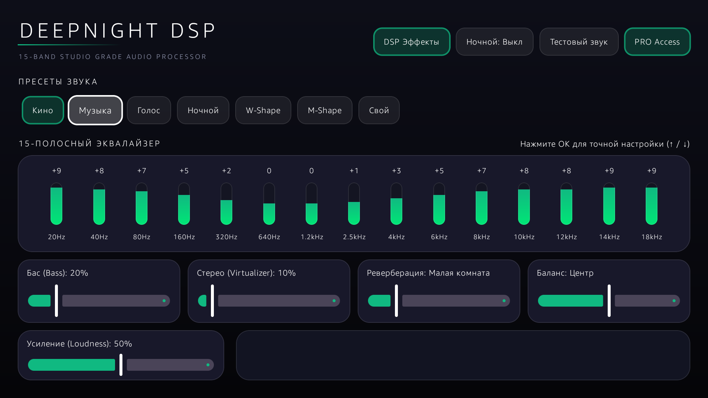

# 🎵 DEEPNIGHT DSP v1.0.0 
Studio Audio Processor for Android TV

> **Автор идеи и концепта**: **`~ИГОРЬ~ (4PDA)`**  
> **Официальный профиль GitHub**: [Igor1974](https://github.com/Igor1974)  
> **Официальный релиз**: [Скачать APK (Releases)](https://github.com/Igor1974/DeepNight-DSP/releases)

---

---

## 🌟 О программе

**DeepNight DSP** — это автономный 15-полосный аудиопроцессор студийного класса, разработанный специально для Android TV, смарт-телевизоров и ТВ-приставок.

Программа кардинально улучшает звучание любых колонок, саундбаров и наушников благодаря нативному C++ ядру обработки спектра.

---

## 🔥 Ключевые возможности

- 🎛️ **15-полосный эквалайзер**: Точная настройка от 20 Гц до 18 кГц с готовыми пресетами (*Кино, Музыка, Голос, Ночной, W-Shape, M-Shape*).
- 🌙 **Ночной режим (Dynamic Range Compression)**: Выравнивает громкость в фильмах — тихому шепоту добавляет разборчивости, а громкие взрывы приглушает.
- 🔊 **Нативный C++ Спектроанализатор**: Точный светодиодный визуализатор спектра с субмиллисекундной задержкой.
- 🎧 **Sub-Bass & 3D Spatializer**: Глубокое усиление инфра-баса и объемная стереопанорама.
- 🏛️ **Студийная реверберация**: 6 профилей помещений и точный баланс каналов.
- ⚡ **Автозапуск (Boot Receiver)**: Автоматический старт при включении ТВ (`BOOT_COMPLETED`).
- 🛡️ **Работает с Root и БЕССРОЧНО БЕЗ Root**: Защищенный фоновый сервис (`Foreground Service`), не закрывающийся системой.
- 📺 **Полная поддержка ТВ-пульта**: Управление D-Pad без вылетов фокуса и вставка ключа из буфера обмена.
- 🌍 **Мультиязычность**: Автоматическая поддержка русского и английского языков (RU / EN).

---

## 💳 Лицензирование и Активация PRO

* **5 дней бесплатного тестового периода** со всеми функциями.
* Бессрочная активация **PRO Ultimate** всего за **390 ₽ ($4)**.

### Инструкция по активации:
1. Отсканируйте QR-код в приложении или перейдите по ссылке на ЮMoney (390 руб.).
2. Отправьте ваш **ID устройства** (отображается в окне приложения) на email: **Deep-Nigth@ya.ru**
3. Введите полученный ключ активации в окне «Ввести ключ PRO».

---

## 📥 Скачать
Готовый установочный APK-файл находится в разделе **[Releases](https://github.com/Igor1974/DeepNight-DSP/releases)**.

---

© 2026 **~ИГОРЬ~ (4PDA)** • ALL RIGHTS RESERVED.  
*Копирование, перепродажа и декомпиляция кода запрещены.*
